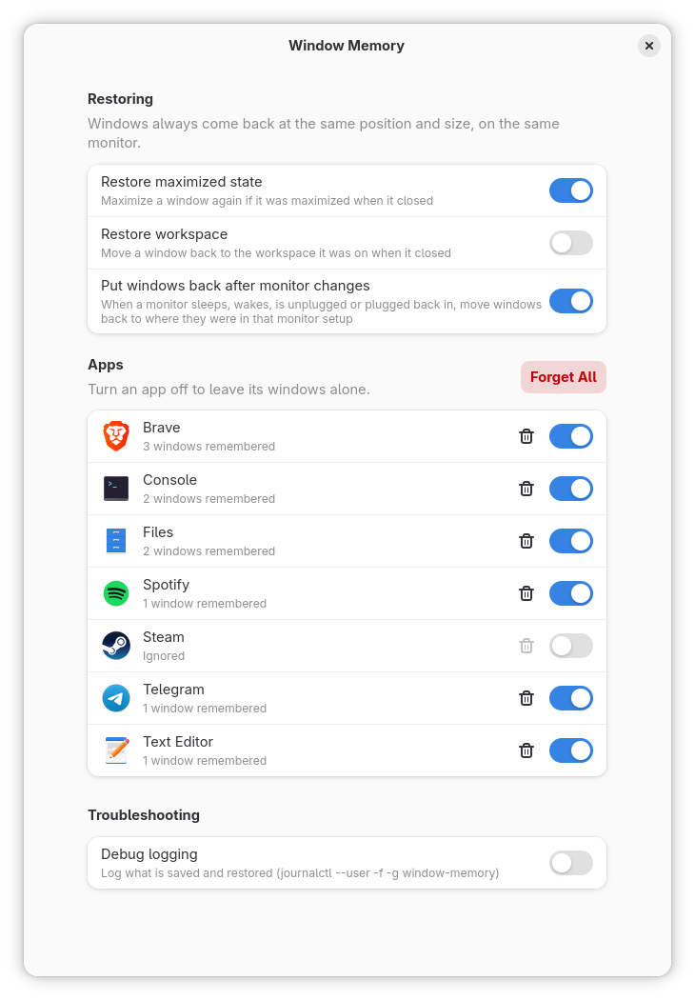

# Window Memory

GNOME remembers where your windows were, like Windows and macOS do.

- **Reopened apps come back where you left them:** same position, same size, same monitor, maximized if they were.
- **No more windows piled onto one screen.** When a monitor goes to sleep, wakes up, is unplugged or comes back after suspend, every window goes back to where it was.
- **Each monitor setup is remembered separately.** Docked, undocked, a monitor switched off: each arrangement keeps its own window positions.
- **Several windows of one app** (two browser windows, three terminals) each go back to their own place.

On Wayland, apps aren't allowed to position their own windows, so on GNOME most apps open wherever GNOME decides, every time. Window Memory does it for them, from inside GNOME Shell.

<picture>
  <source media="(prefers-color-scheme: dark)" srcset="docs/preferences-dark.png">
  
</picture>

**If this is useful to you, please ⭐ [star the repo](https://github.com/Jire/window-memory) and [follow @Jire on GitHub](https://github.com/Jire) for more free tools like this.**

## Install

Paste the command for your distro into a terminal. Don't use `sudo`: it installs into your home folder.

**Arch Linux, EndeavourOS, CachyOS, Manjaro**

```bash
curl -fsSL https://raw.githubusercontent.com/Jire/window-memory/main/install.sh | bash
```

**Fedora**

```bash
curl -fsSL https://raw.githubusercontent.com/Jire/window-memory/main/install.sh | bash
```

**Ubuntu and Ubuntu-based** (uses `wget`, which Ubuntu ships with by default)

```bash
wget -qO- https://raw.githubusercontent.com/Jire/window-memory/main/install.sh | bash
```

Then **log out and back in**. GNOME only loads newly installed extensions at login (or see the next section to load it right away).

The installer downloads the latest release, installs it with `gnome-extensions`, turns it on, and tells you if anything else is needed. That's all: from then on, move and resize windows as usual and they'll be remembered.

### Load without logging out (Wayland)

GNOME's built-in Looking Glass console can load the extension into the running session:

1. Press <kbd>Alt</kbd>+<kbd>F2</kbd>, type `lg`, press <kbd>Enter</kbd>.
2. Paste this line into the prompt at the bottom and press <kbd>Enter</kbd>:

   ```js
   eval(new TextDecoder().decode(imports.gi.GLib.file_get_contents(imports.gi.GLib.get_user_data_dir() + '/window-memory/hot-load.js')[1]))
   ```

3. Press <kbd>Esc</kbd>. A notification confirms it loaded.

This also works for reloading after an update. At your next normal login the regular installed copy loads as usual.

## Settings

Open **Extensions** and click the gear next to Window Memory, or run:

```bash
gnome-extensions prefs window-memory@jire.github.io
```

If you don't have the Extensions app, install it with `sudo pacman -S gnome-extensions-app` (Arch), `sudo dnf install gnome-extensions-app` (Fedora) or `sudo apt install gnome-shell-extension-prefs` (Ubuntu).

| Setting | Default | What it does |
| --- | --- | --- |
| Restore maximized state | On | A window that was maximized opens maximized again, on the same monitor. |
| Restore workspace | Off | A window opens on the workspace it was on when it closed. |
| Put windows back after monitor changes | On | When monitors are added, removed, turned off or rearranged, windows go back to where they were the last time that setup was in use. |
| Apps | | Turn an app off to leave its windows alone, or forget what was saved for it. |

## Update

Run the install command again.

## Uninstall

```bash
curl -fsSL https://raw.githubusercontent.com/Jire/window-memory/main/install.sh | bash -s -- --uninstall
```

(On Ubuntu, swap the start for `wget -qO- …`.) This keeps your saved window positions in `~/.local/state/window-memory/` in case you reinstall. Use `--purge` instead of `--uninstall` to delete those too. You can also remove the extension from the **Extensions** app.

## Requirements

- **GNOME Shell 49, 50 or 51.** Check yours with `gnome-shell --version`. That covers current Arch and its derivatives, Fedora 43 and newer, and Ubuntu 25.10 / 26.04 LTS and newer.
  - Developed on GNOME 51 (Arch Linux, Wayland), with automated tests in a headless GNOME Shell 51 using virtual monitors: reopening windows, maximized windows, several windows of one app, unplugging and replugging monitors, and apps that move their own window.
  - GNOME 49 and 50 have exactly the same window and monitor APIs (checked against Mutter's source) but haven't been tested yet. Please [open an issue](https://github.com/Jire/window-memory/issues) if something looks wrong.
  - GNOME 48 and older don't expose the monitor information Window Memory needs.
- It doesn't depend on the app's toolkit: GTK, Qt, Electron, browsers and XWayland apps (Steam, many games) are all handled the same way, by GNOME Shell. The automated tests use native Wayland GTK windows.

## How it works

- **Remembering:** whenever you move, resize, maximize or un-maximize a window, its position is saved to `~/.local/state/window-memory/windows.json`, along with which monitor it was on. Positions are stored relative to that monitor, so rearranging your monitors doesn't break them.
- **Restoring:** when an app opens a window, it's moved to where that app's window last was as soon as it appears. Some apps (Electron apps and browsers especially) move their own window while starting up; for two seconds after a restore, Window Memory puts it back if that happens. Grabbing the window yourself always wins.
- **Which window is which:** each app keeps a few window "slots". A new window takes the slot that matches it best: same window type, then same title, then whichever window of that app closed most recently.
- **Monitors:** monitors are recognised by their EDID (make, model and serial number), the same thing Windows and macOS use, so swapping cables or ports doesn't confuse it. Positions are saved separately for every monitor setup you use.
- **Monitor changes:** when a monitor disappears, GNOME shuffles its windows onto the remaining screens. Window Memory stops recording while that happens. Once the setup has been stable for three seconds, it moves every window back to where it was in that setup. It keeps running while the screen is locked, because that's exactly when monitors tend to go to sleep and come back.
- **Left alone:** dialogs, popups, menus and splash screens; windows that were already open when the extension started (unlocking your screen or reloading never rearranges anything); and apps you've turned off in the settings.

It doesn't relaunch apps at login. It restores windows when the apps open, whether you start them yourself or they autostart.

## Troubleshooting

```bash
gnome-extensions info window-memory@jire.github.io   # is it enabled? any errors?
journalctl --user -f -g window-memory                 # what it's doing (turn on Debug logging in the settings first)
```

With debug logging on, every save and restore is logged. If a window isn't restored, open and move it while watching the log, and include the output in an issue.

## Build from source

```bash
git clone https://github.com/Jire/window-memory.git
cd window-memory
npx --yes eslint@9 .                               # lint
scripts/build.sh                                   # creates dist/<uuid>.shell-extension.zip
./install.sh --zip dist/window-memory@jire.github.io.shell-extension.zip
```

After changing code, rebuild, reinstall with `--zip`, and run the Looking Glass line above to reload without logging out. [AGENTS.md](AGENTS.md) describes the code layout and how to test changes in a separate, headless GNOME Shell.

## Support

This is free software, made in my spare time. The best ways to support it:

- ⭐ [Star the repo](https://github.com/Jire/window-memory), which helps other people find it.
- 👤 [Follow @Jire on GitHub](https://github.com/Jire) to hear about more free tools like this.
- 🐛 [Report bugs or request features](https://github.com/Jire/window-memory/issues), especially if you've tried it on GNOME 49 or 50.

## License

[GPL-2.0-or-later](LICENSE), the same license as GNOME Shell.
